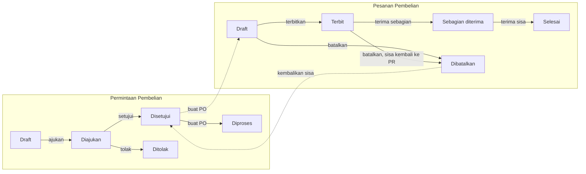

# Buku Gudang

[](https://github.com/Koandres/buku-gudang/actions/workflows/ci.yml)

Mini ERP untuk alur **permintaan pembelian → persetujuan → pesanan pembelian → penerimaan barang bertahap → kartu stok**, dilengkapi dashboard, laporan dengan ekspor CSV, dan log aktivitas.

Aplikasi ini dibuat sebagai **studi kasus portofolio**. Seluruh nama, alamat, harga, dan transaksi adalah **data fiktif**.

## Kebutuhan sistem

| Kebutuhan | Versi / catatan |
| --- | --- |
| PHP | **8.4 atau lebih baru** (`composer.json`) |
| Composer | 2.x |
| Ekstensi PHP | `sqlite3`, `pdo_sqlite`, `mbstring`, `dom`, `curl`, `zip`, `intl`, `bcmath` |
| Node.js | `^20.19.0` atau `>=22.12.0` (dibutuhkan Vite 8) |
| Database | SQLite (WAL, `foreign_keys`, `busy_timeout`, `transaction_mode=IMMEDIATE`) |

## Tumpukan teknologi

- Laravel 13 dengan SQLite, Eloquent dan migration agar tetap agnostik database.
- Inertia.js + React 19 + Vite (starter kit), tanpa paket Composer/npm tambahan di luar starter kit.
- Pest untuk tes otomatis dan Pint untuk format kode.
- Tampilan bertema "Buku Besar" melalui `resources/css/tokens.css`, font lokal, CSS cetak terpisah, dan tanpa CDN.

## Fitur utama

- **Master data:** supplier, barang, gudang, dan pengguna dengan hak akses per peran.
- **Permintaan pembelian (PR):** buat draft, ajukan, setujui/tolak (persetujuan diri sendiri dilarang), dan tandai sedang diproses. Pemohon hanya melihat PR miliknya.
- **Pesanan pembelian (PO):** dibuat dari PR secara sebagian maupun penuh, terbitkan, batalkan dengan pengembalian sisa PR, serta cetak PO.
- **Penerimaan barang (GR):** terima sebagian atau seluruh isi PO; status PO bergerak otomatis menjadi `Sebagian diterima` atau `Selesai`.
- **Stok:** kartu stok per barang dan gudang, saldo dihitung dari seluruh mutasi, serta penyesuaian stok bernomor `ADJ`. Kartu stok hanya untuk Gudang, Pembelian, dan Admin.
- **Laporan:** ringkasan, PO outstanding, pembelian per supplier, stok per gudang, dan barang perlu dipesan; semuanya dapat diekspor ke CSV. Dashboard dan laporan yang menampilkan nilai uang hanya untuk Pembelian dan Admin.
- **Audit:** log aktivitas untuk perubahan dokumen dan data master (khusus admin).
- Antarmuka responsif dengan mode terang/gelap.

## Hak akses ringkas

| Area | Pemohon | Penyetuju | Pembelian | Gudang | Admin |
| --- | --- | --- | --- | --- | --- |
| Dashboard | — | — | ✅ | — | ✅ |
| Laporan bernilai uang + ekspornya | — | — | ✅ | — | ✅ |
| Laporan stok per gudang | ✅ | ✅ | ✅ | ✅ | ✅ |
| Daftar & detail PR | ✅ punya saja | ✅ semua | ✅ semua | ✅ semua | ✅ semua |
| Buat/ajukan PR | ✅ | — | — | — | ✅ |
| Setujui/tolak PR | — | ✅, bukan punya | — | — | ✅ |
| Daftar & detail PO | ✅ | ✅ | ✅ | ✅ | ✅ |
| Buat/terbitkan/batal PO | — | — | ✅ | — | ✅ |
| Daftar & detail GR | ✅ | ✅ | ✅ | ✅ | ✅ |
| Catat GR / kartu stok | — | — | ✅ kartu saja | ✅ | ✅ |
| Log aktivitas | — | — | — | — | ✅ |

Semua pembatasan ditegakkan di server lewat Policy/Gate, bukan hanya dengan menyembunyikan menu.

## Instalasi

```bash
composer install
cp .env.example .env
php artisan key:generate

# Pastikan berkas database ada:
# PowerShell: New-Item -ItemType File database\database.sqlite
# macOS/Linux: touch database/database.sqlite

php artisan migrate --seed
npm install
npm run build
php artisan serve
```

Jika memakai Laravel Herd, buka `http://buku-gudang.test`. Rangkaian `composer setup` juga dapat dipakai untuk sebagian besar langkah di atas. Saat mengembangkan antarmuka, jalankan `npm run dev` di terminal terpisah. Laravel Boost terdaftar sebagai dev dependency (`laravel/boost`) dan dipakai untuk panduan pengembangan.

Seeder hanya berjalan di luar production; `migrate --seed` aman dijalankan ulang karena data contohnya idempoten.

## Data awal

```bash
php artisan db:seed
```

Perintah ini mengisi lima akun peran **dan** data contoh fiktif selama enam bulan dengan semua status dokumen, penerimaan, mutasi stok, dan log aktivitas. Untuk mengisi akun saja:

```bash
php artisan db:seed --class=RoleAccountSeeder
```

| Peran | Email |
| --- | --- |
| Pemohon | `pemohon@bukugudang.test` |
| Penyetuju | `penyetuju@bukugudang.test` |
| Pembelian | `pembelian@bukugudang.test` |
| Gudang | `gudang@bukugudang.test` |
| Admin | `admin@bukugudang.test` |

Kata sandi kelima akun demo di atas: **`password`**. Seeder tidak berjalan di environment `production`. Pengguna baru yang dibuat admin harus diberi **sandi awal**; tidak ada lagi kata sandi default. Setiap pengguna dapat mengubah sandinya sendiri lewat `/profile/password`.

## Alur singkat

1. **Pemohon** membuat PR, memilih barang dan jumlah, lalu mengajukannya.
2. **Penyetuju** menyetujui atau menolak PR disertai alasan.
3. **Pembelian** membuat PO dari PR yang disetujui, lalu menerbitkannya.
4. **Gudang** mencatat penerimaan; satu PO dapat diterima beberapa kali hingga selesai.
5. Mutasi penerimaan masuk ke kartu stok; penyesuaian dapat dicatat bila ada selisih fisik.
6. Dashboard dan laporan bernilai uang dipantau oleh Pembelian dan Admin; Admin juga memantau log aktivitas.

## Diagram alur status



## Penomoran dan aturan bisnis

- Nomor dokumen mengikuti pola `PREFIX-YYYYMM-0001` dengan prefiks `PR`, `PO`, `GR`, dan `ADJ` dari `config/erp.php`.
- Nomor diambil dari tabel `document_sequences` di dalam transaksi. Karena SQLite mengabaikan `lockForUpdate()`, keamanan nomor bergantung pada transaksi `IMMEDIATE` (`config/database.php`, aktif pada PHP 8.4+) dan indeks unik `(prefix, period)`; proses yang bentrok saat membuat baris sequence mencoba mengambil ulang baris tersebut.
- Data contoh memakai blok `0101` supaya tidak bentrok dengan dokumen uji, dan sequences diselaraskan setelah seeding.
- Uang dan jumlah disimpan sebagai bilangan bulat (rupiah tanpa desimal).
- Jumlah penerimaan tidak boleh melebihi sisa PO. Pembatalan PO mengembalikan sisa ke PR.
- Saldo stok selalu dihitung ulang dari buku besar mutasi, bukan dari kolom saldo tersimpan.
- Perubahan yang menyentuh banyak tabel dijalankan di dalam transaksi; aturan bisnis ada di `app/Services`, validasi di `app/Http/Requests`, dan otorisasi di `app/Policies`.

## Struktur penting

| Lokasi | Isi |
| --- | --- |
| `app/Services` | Aturan bisnis PR, PO, GR, stok, penomoran, laporan, dan ekspor CSV |
| `app/Enums` | Status dokumen, jenis mutasi, dan peran pengguna |
| `app/Policies`, `app/Http/Requests` | Otorisasi dan validasi |
| `app/Http/Controllers` | Orkestrasi request dan props Inertia |
| `resources/js/Pages` | Halaman React per modul |
| `resources/css/tokens.css` | Token warna, tipografi, dan tema "Buku Besar" |
| `config/erp.php` | Prefiks dokumen, satuan, dan format mata uang |
| `database/seeders/SampleDataSeeder.php` | Data contoh fiktif |
| `.github/workflows/ci.yml` | Pemeriksaan Pint, tes, dan build di GitHub Actions |
| `docs/PANDUAN-MODIFIKASI.md` | Panduan modifikasi (berkas lokal, masuk `.gitignore`) |

## Perintah pengembangan

```bash
php artisan test                       # menjalankan seluruh tes
vendor/bin/pint --test --format agent  # memeriksa gaya kode tanpa mengubah berkas
npm run build                          # membangun aset frontend untuk produksi
```

## Pemecahan masalah

| Gejala | Penyebab umum | Penanganan |
| --- | --- | --- |
| `403` saat membuka halaman | Akun nonaktif atau peran tidak memiliki hak | Aktifkan akun atau gunakan peran yang sesuai (lihat matriks hak akses) |
| `npm run build` gagal mengenali font lokal | Berkas font di `public/fonts` belum ada | Pastikan aset lokal tersalin; proyek tidak memakai CDN |
| Nomor dokumen terlihat ganda di PHP 8.3 | `transaction_mode=IMMEDIATE` hanya dipakai PHP 8.4+ | Gunakan PHP 8.4 atau lebih baru |
| `db:seed` tidak menambah data di produksi | Seeder sengaja dijaga agar tidak berjalan di production | Jalankan hanya di local/staging |
| CSV terbuka sebagai rumus di spreadsheet | Nilai diawali `=`, `+`, `-`, atau `@` | Ekspor sudah menambahkan `'`; jangan dihapus sebelum dibuka |

## Batasan yang disengaja

- Belum ada retur barang ke supplier; koreksi dilakukan lewat penyesuaian stok.
- GR tidak bisa dibatalkan; selisih fisik dicatat sebagai penyesuaian stok bernomor `ADJ`.
- Transfer stok antar gudang belum tersedia.
- Seluruh data adalah fiktif untuk keperluan demo dan portofolio.

## Tangkapan layar

| Tampilan | Gambar |
| --- | --- |
| Dashboard | _belum tersedia_ |
| Daftar PR | _belum tersedia_ |
| Detail PO & cetak | _belum tersedia_ |
| Kartu stok | _belum tersedia_ |
| Laporan | _belum tersedia_ |

## Lisensi

Proyek ini menggunakan lisensi **MIT**.

## Catatan

- Tidak ada aset atau font yang dimuat dari CDN.
- `CHANGELOG.md` mencatat rencana dan hasil pekerjaan; `AGENTS.md` berisi aturan kerja agen pada proyek ini.
